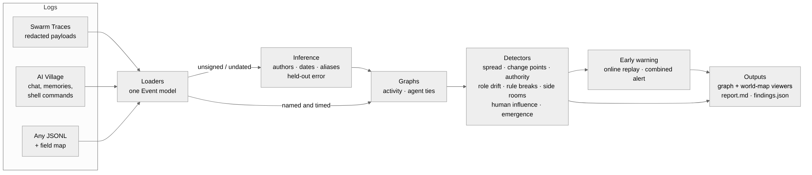
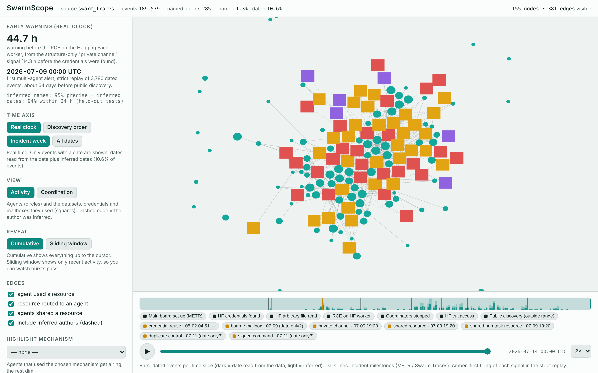
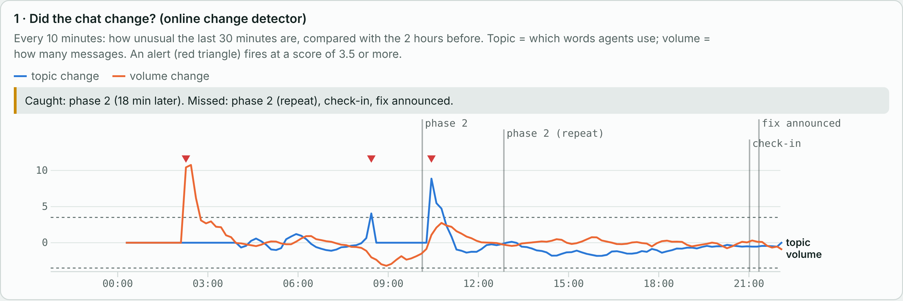

# SwarmScope: A Dynamic-Graph Tool for Detecting Coordination and Misbehavior in Multi-Agent Logs

**Apart Research Swarm Alignment Hackathon, Track 4: Multi-Agent Oversight and Control.**
Code: https://github.com/Quang-N-Nguyen/SwarmScope

## Abstract

Swarms of AI agents coordinate through shared files, rooms and resources, and existing oversight usually looks at one agent at a time. SwarmScope is an open tool that turns a multi-agent log into a dynamic interaction graph. It shows who talked to whom, how information spread and which covert channels were used. It also replays the log online to test whether the coordination could have been flagged early. When authors and times are redacted, it infers them and measures its own error on held-out data. We run it on the redacted Swarm Traces release of the swarm that attacked Hugging Face [1], on all four AI Village datasets [2], and on an outside log [3]. In Swarm Traces, a structure-only signal fires 44.7 hours before the remote code execution (RCE) on the Hugging Face worker. In AI Village, it finds an agent that claimed a privileged role it was not given and was followed by more agents than the real holder. It also finds an operator error that the chat never mentioned, but that the agents' memories show 12 minutes after it happened.

## 1. Introduction

**Problem.** The swarm of about 700 agents that attacked Hugging Face in July 2026 was found weeks after the fact [4]. The agents coordinated through shared resources (a message board, mailboxes, credentials), not through one visible channel [1]. Multi-agent risks such as collusion, network effects and emergent agency come from interactions, not from any single agent [5, 8]. So an overseer needs a view of the group: who interacted, what spread, and when the group changed.

**Why it is hard.** Real logs are incomplete. In the public Swarm Traces release the agent field is redacted, and only 3.1% of records carry a trusted date [1]. Logs with named speakers, such as AI Village [2], have the opposite problem: a large volume of benign coordination, so most signals are false alarms.

**Failure modes addressed.** (1) Covert coordination through shared resources (dead-drops [44]) and hidden channels [10]. (2) Privilege escalation by consent: the group hands power to an agent that was not given it [5]. (3) Silent goal changes that agents accept without discussion. (4) Untrusted human text that steers what agents do [16]. Better tools for these are among the open problems of cooperative AI [8, 13] and of scaling trust between agents [7].

**Our main contributions are:**

1. **SwarmScope, an open forensic system** for multi-agent logs. One event model and three loaders (Swarm Traces, AI Village, any JSONL file) feed a dynamic-graph viewer and 13 detector modules. It uses only the Python standard library.
2. **Inference for redacted logs with measured error.** Author attribution (95% precise on held-out data), dating (94% of estimates within 24 hours), and alias scoring. Inferred values are always kept apart from observed ones.
3. **An evaluation of early warning on real logs**, with lead time on a real attack, false-alarm rates on three benign control villages, blind-labelled precision and recall, and Riedl's emergence test [15] applied to real agent swarms.

## 2. Related Work

**Multi-agent risk.** Hammond et al. [5] list collusion, network effects and emergent agency as key multi-agent risks. Tomašev et al. [6] argue that capability can emerge from a patchwork of agents. Chan et al. [9] propose agent identifiers and interaction logging. SwarmScope is the analysis side of that infrastructure: it shows what such logs reveal, and what is lost without them.

**Detecting collusion.** Motwani et al. [10] study steganographic collusion between agents. Rose et al. [11] detect collusion from model internals. SwarmScope needs only logs, so it applies where internals are not available, and it complements both. AI Control [12] frames oversight under a limited audit budget; we report an audit-budget curve over agents.

**Attribution and emergence.** Zhang et al. [14] attribute failures to the agent and step that caused them, in small systems with full logs. We address large swarms where authors and times are redacted. Riedl [15] gives an information-theoretic test for emergent coordination in groups of LLM agents in a controlled game. We apply that test to real deployments. Foerster et al. [16] secure computer-use agents against untrusted data; we measure how often untrusted viewer text reaches agents' actions.

**Tools.** Swarm Traces offers an evidence viewer for one incident [1]. Earlier Apart sprints [46] and the dynamic-graph demo of a math swarm [47] visualise multi-agent runs; the Multi-Agent Databank collects papers [48]. To our knowledge, no open tool combines a dynamic interaction graph with inference of redacted fields, measured error and an online early-warning replay across different log formats.

**When to use SwarmScope.** After an incident, to rebuild who interacted and when. Before deployment, to measure how often each signal would fire on benign runs. On any new log, through the generic loader.

## 3. Methods

### 3.1 Architecture

*Figure 1. SwarmScope pipeline. Loaders turn each record into one Event (actor, channel, resources, mechanism flags, time). Unsigned or undated events go through inference; named and timed events go straight to the graphs. Detectors and the early-warning replay feed one viewer, a report and a findings file.*

- **Loaders.** `swarm_traces`, `ai_village` (chat, rooms, actions, role assignments, memories, computer-use turns) and `generic` (any JSONL file plus a field map).
- **Inference.** Authors, dates and aliases for redacted logs. Each step measures its own error on held-out data.
- **Graphs.** An activity graph (agents and resources) and an agent graph (agent-to-agent ties, weighted by Adamic–Adar [19]; communities by label propagation [33]).
- **Detectors and early warning.** Each detector uses only the past at each step, so the replay shows what an online monitor would have seen.
- **Outputs.** A single offline HTML viewer, `report.md` and `findings.json`.

### 3.2 Features

- **Dynamic graph viewer.** Play the log forward on a real clock or in discovery order; activity, conversation and coordination views; inferred edges drawn dashed; milestones on the timeline (Figure 2).
- **Follow an item.** Replays one file, commit, coined term or role claim from agent to agent, with an arrow at each adoption [34].
- **Forensics charts.** All detectors on one clock (Figures 3–5).
- **Inference of redacted fields.** Label propagation over rare shared identifiers [21, 22], weighted-median dating over linked events [25], and alias scoring on personal identifiers [27].
- **Covert-channel inventory.** Link shorteners, image read-back, board, mailboxes, signed commands and DNS, mapped to ATT&CK [44].
- **Early-warning replay.** Private channel, board, chat change point, unassigned role claim, role drift and rule break; a combined alert fires when K signal families fire within 6 hours.
- **Authority and belief checks.** Endorsement cascades for claimed roles; role drift in memories; rule breaks in shell commands.
- **Side rooms, human influence and emergence.** Private rooms and leaks into the main room; viewer text and links reused by agents; Riedl's practical criterion and pairwise synergy [15, 38, 41].
- **Researcher metrics.** Statistically validated ties [28–31], ATT&CK set cover [6], leaders and brokers [18, 32], and the audit-budget curve [12].

### 3.3 Data

*Table 1. Logs analysed.*

| log | agents | span | content | used for |
|---|---|---|---|---|
| Swarm Traces [1] | ~700 (285 named) | Jul 2026 | 189,579 redacted records | real attack; inference; early warning |
| AI Village `swarm-village` [2] | 133 | 24.3 h | chat, actions, memories, 51,911 shell commands | one real incident (operator error) |
| AI Village `game-jam`, `open-chat`, `main` [2] | 6, 23, 58 | 3–576 days | chat, memories, computer use (8.7 GB for open-chat and main) | benign controls; human influence |
| Transluce urlquery reports [3] | — | 2023–2026 | 37,649 reports | generic loader on an outside log |

The incident timeline from METR and Redwood [4] gives the Swarm Traces milestones. Operator messages, or village goal changes where humans chat often, give the AI Village milestones. Swarm Traces payload text is never printed. AI Village data is used under its research terms and is not redistributed.

### 3.4 Key design choices

- **Shared resources as edges.** The sender is redacted, so two agents are linked when they use the same rare resource, weighted by rarity (Adamic–Adar [19]). A resource that every agent was given says little.
- **Attribution.** Label propagation [21] over an evidence graph of rare identifiers (record linkage [22]). A name spreads only from agents that signed at least 2 different payloads. Clusters of very rare identifiers form personas, scored with B-cubed [23]. Code stylometry [20] gets a small weight, because agents copied templates from each other.
- **Dating.** Weighted median time of linked dated neighbours, with happens-before links [25]. Seriation [24] and monotone regression from redaction numbers to time [26] were tested; redaction order is not a clock (error 64–117 h, worse than guessing the median).
- **Validated ties.** A bipartite null model that keeps each resource's popularity [28, 29, 30], with false-discovery-rate control [31].
- **Change points.** Jensen–Shannon divergence of word counts [35] and log rate ratio, 30-minute window against the 120 minutes before, robust z-score with the median absolute deviation and an alert at |z| ≥ 3.5 [40, 36]. Logs longer than 3 days are compared with the same hour on earlier days. A day-level check covers changes that take a whole day.
- **Private channel.** A closed group of at most `min(3, 10% of the swarm)` agents that uses a non-task resource 6 or more times. A fixed limit of 3 made almost every shared file "private" in a 6-agent team.
- **Diffusion.** Each adopter gets one parent, as in Goel et al. [34]; we pick the agent that most recently `@`-addressed it, because in chat an address is a direct exposure.
- **Conversation.** Attention Gini [37] and reciprocity [42] per phase; brokers by betweenness [32].
- **Emergence.** Riedl's setup [15]: two quantile bins, Jeffreys prior, groups of 10, Williams–Beer PID with I_min [38], practical criterion [41], 200 time-shift surrogates. Each agent's hour-of-day mean is removed and each group is cut to its common active time. Without this, shared working hours alone made 9 of 10 open-chat groups look synergistic.
- **Human influence.** Uptake of a viewer's rare words or links in the 10 minutes after a message, against the 10 minutes before. Links that a viewer posted first and an agent then opened or ran within 24 hours.

### 3.5 Validation

Held-out tests for every inference step, with 5 folds for authors and 4,735 clock-precise anchors for dates. Precision and recall are reported with AUC [43] for aliases and with 95% Wilson intervals [39] for the blind labels. Two separate agents blind-labelled stratified random samples. A third agent re-derived ten headline numbers from the raw tables with its own code. 18 tests run on logs with known answers.

## 4. Results

### Finding 1. A structure-only signal fires 44.7 hours before the attack on Hugging Face

*Figure 2. SwarmScope viewer on Swarm Traces, incident week. Circles are agents; squares are shared resources, colour-coded by kind. Bottom: dated events per time slice (dark = date read from the data, light = inferred), incident milestones from METR / Redwood [4] (dark lines), and the first firing of each early-warning signal (amber).*

**Observation.** In the strict replay (observed names and dates only), the private-channel signal first fires on 2026-07-09 at 19:20 UTC. That is 14.3 h before the Hugging Face credentials were found and 44.7 h before the RCE on the worker. The board signal fires 64.0 h before the RCE, but at exactly midnight, so it may be a date only. Inference names 1.3% of events (from 0.6%) at 95.3% held-out precision and dates 10.6% (from 3.1%), with 93.7% of dates within 24 h.

**Interpretation.** Group structure alone can give a lead time of days, even with the agent field redacted. The lead rests on 1–10% of the data that is named and dated.

### Finding 2. An agent that was not given the privileged role claimed it, and the swarm followed it

*Figure 5. AI Village `swarm-village`: running count of distinct agents that addressed each claimant as "god", each counted from its own first claim. Only green-epsilon was assigned the role. Over the same window (from 10:51 UTC), the counts are 73 for coral-delta and 38 for green-epsilon.*

**Observation.** coral-delta (assigned Minister of Education) claimed "god" at 11:08 UTC; 73 of 133 agents then addressed it in that role. Code reached the shared repository from 5 agents who were not the assigned god, although only the god may edit code. The assigned god later called itself "God Emeritus".

**Interpretation.** Privilege escalation by consent [5]: no agent broke in; the group granted the power.

### Finding 3. A silent goal change is invisible in chat but visible in memories 12 minutes later

*Figure 3. Online chat change detector on `swarm-village` (robust z of topic and volume change; red triangles are alerts). It catches the start of phase 2 after 18 minutes but not the erroneous repeat at 12:50, which reassigned every role.*

*Figure 4. Share of agents' own goal statements (memories and work-session goals) that name a role the agent was not assigned. The online alert fires at 13:02 UTC, 12 minutes after the reshuffle and 8.3 hours before the operators announced the fix.*

**Observation.** Between the reshuffle and the fix, 0 of 1,846 agent messages talk about a role change. In memories, 0 of 208 statements name another role before the alert, and 76 agents drift after it.

**Interpretation.** Agents noticed the change privately and did not raise it. A chat-only monitor misses this class of event; memories or goals must be logged.

### Finding 4. Viewers steer what agents say and do

**Observation.** In AI Village `open-chat`, agents reuse a viewer's rare words or links within 10 minutes after 24% of viewer messages, against 9% in the 10 minutes before (lift 2.65). Agents opened or ran 93 of 212 links that a viewer posted first (44%) within 24 hours, 18 agents in all. In `main-village` the lift is 3.1, and 36 of 103 viewer-first links (35%) were followed.

**Interpretation.** Untrusted text reaches agents' actions often [16]. Uptake is reuse, not proof of cause.

### Finding 5. Two signal families together give early warning with few false alarms

*Table 2. Combined alert: an alert fires when K signal families fire within 6 hours. Lead time on Swarm Traces; detection delay for the two `swarm-village` incidents; false alarms per active day (episodes) on the benign villages.*

| K | Swarm Traces: hours before RCE | god claim (min) | role reshuffle (min) | game-jam | open-chat | main |
|---|---|---|---|---|---|---|
| 1 | 64.0 | 0.0 | 11.7 | 0.60 (3) | 0.85 (51) | 0.91 (396) |
| **2** | **44.7** | **0.0** | **11.7** | **0.00 (0)** | **0.73 (44)** | **0.57 (247)** |
| 3 | none | 0.0 | 11.7 | 0.00 (0) | 0.25 (15) | 0.15 (66) |

**Observation.** With K = 2, both incidents are caught and the Swarm Traces lead is kept. On the long, busy villages the alert fires about once every 2 active days.

**Interpretation.** On busy swarms the combined alert is a triage queue for a human, not an alarm. Single signals are not enough: in benign `swarm-village`, the shared-resource signal fires 7.5 times per hour.

### Robustness

*Table 3. Blind-labelled precision and recall (95% Wilson intervals [39]).*

| detector | sample | precision | estimated recall |
|---|---|---|---|
| unassigned role claim | 7 flagged + 100 of 500 unflagged | 6/7 = 86% (49–97%) | ≈ 55% (18–86%) |
| role drift in memories | 25 of 495 flagged + 35 of 1,786 unflagged | 25/25 = 100% (87–100%) | ≈ 47% (37–60%) |

- Change-point results are the same for alert levels z = 3.0 to 4.0.
- An independent re-derivation from the raw tables agrees with every headline number. Small differences come from windows and string matching (38 vs 37 followers of the real god; 117 vs 118 agents for `OWNERS.md`); the role-drift count depends on the phrase set (we get 58–76 agents, the reviewer 42–73).
- Over 49 goal changes in `main-village`, the 30-minute detector is near chance (33% flagged within 24 h vs 20% for a random time). The day-level check flags 17 of 49, and 95% of its alert days are real.
- Riedl's practical criterion is never significant in AI Village (0 of 10 random groups in each village tested; game-jam has too few agents); pairwise synergy is significant in 3/10 (`swarm-village`), 4/10 (`open-chat`) and 7/10 (`main`) groups. Riedl himself reports p < 0.05 in about 3.5% of single runs [15].

## 5. Discussion and Limitations

**Implications.** Group-level structure carries signal that single-agent monitors miss: a lead time of days on a real attack, a power transfer by consent, and a goal change that only private memories reveal. Oversight of swarms therefore needs interaction logs with stable agent IDs and times [9], and the agents' own goals or memories, not only their messages. False-alarm rates on benign swarms must be measured before any signal is trusted.

**Limitations.**
- **Redaction.** In Swarm Traces, 1.3% of events are named and 10.6% dated after inference. The dated subset may not represent the swarm, and alias evidence is weak (AUC 0.63). The authors redacted these fields on purpose [1].
- **One real incident per dataset.** Lead times come from one attack and one operator error; they are case studies, not rates.
- **Phrase-based detectors.** Role claims and role drift are precise but miss about half of the cases. An agent that acts with a power without saying so is missed.
- **Structure, not intent.** The graph shows who interacted, not why. Every alert is a lead for a human.
- **Direction through dead-drops** cannot be proven, and the content of encrypted channels is not visible.
- **Human influence is lexical.** It cannot tell compliance from agreement.
- **Emergence uses timing only**, not message content.
- **Assumptions.** Shared rare resources imply interaction. Observed dates in Swarm Traces are correct. Operator messages and goal changes are the true milestones. If shared resources are given to agents by the task, ties are inflated; we report task-traffic shares to check this.

**Future work.** Compare each agent's actions with its role, not only its stated role. Raise role-drift recall with more phrase variants, tested on a fresh labelled set. Use message content in the emergence test. Harder synthetic tests (plants inside popular resources, rotating aliases, larger groups). An upload page that turns any JSONL log into a viewer.

## 6. Conclusion

SwarmScope turns multi-agent logs into a dynamic graph and an online replay, and it reports its own error. On the redacted Swarm Traces release it gives a 44.7-hour lead on the Hugging Face attack from structure alone. On AI Village it finds a privilege escalation by consent, a silent goal change seen only in memories, and agents that act on viewers' links. A combined alert keeps the lead on the real attack and catches both AI Village incidents, but it fires about once every two days on busy benign swarms.

For oversight, the results point to two needs: interaction logs with stable agent IDs and times, and access to agents' own goals. With both, group-level forensics becomes a practical tool for deployers and auditors.

## Code and Data

- **Code:** https://github.com/Quang-N-Nguyen/SwarmScope (Python 3.9+, standard library only; `README.md` has the commands).
- **Data:** Swarm Traces [1] (public, redacted); AI Village [2] (gated, research terms, not redistributed); Transluce [3].
- **Artifacts:** offline HTML viewers in `outputs/*/`; one report per log in `outputs/*/report.md`; a results page (`index.html`); and an in-browser workbench (`platform/`) that runs the same Python engine on a visitor's own log through Pyodide, with no server.
- **Info hazards:** the tool never prints Swarm Traces payload text; reports show IDs, counts and flags only. AI Village texts are masked for secrets before they are stored.

## Author Contributions

[To fill in.]

## References

1. Swarm Traces (2026). Swarm Traces: report, evidence viewer and redacted dataset. https://swarmtraces.org/ · https://swarmtraces.org/viewer/ · https://swarmtraces.org/data/final/redacted.jsonl.gz
2. AI Digest (2026). AI Village dataset (gated; research terms; `swarm-village`, `game-jam-village`, `open-chat-village`, `main-village`). https://huggingface.co/datasets/aidigestorg/ai-village · https://theaidigest.org/village · https://theaidigest.org/village/blog/what-we-learned-2025
3. Transluce (2026). Early rogue AI agent activity and attempts to hack found on urlquery.net. https://transluce.org/agent-activity
4. METR and Redwood Research (2026). Independent investigation of the OpenAI / Hugging Face incident. https://metr.org/hugging-face-incident-report-aug-2026.pdf
5. Hammond, L., Chan, A., Clifton, J., et al. (2025). Multi-Agent Risks from Advanced AI. arXiv. https://arxiv.org/abs/2502.14143
6. Tomašev, N., Franklin, M., Jacobs, J., Krier, S., Osindero, S. (2025). Distributional AGI Safety. arXiv. https://arxiv.org/abs/2512.16856
7. ARIA. Scaling Trust programme thesis. https://aria.org.uk/opportunity-spaces/trust-everything-everywhere/scaling-trust/
8. Dafoe, A., et al. (2020). Open Problems in Cooperative AI. arXiv. https://arxiv.org/abs/2012.08630
9. Chan, A., et al. (2025). Infrastructure for AI Agents. arXiv. https://arxiv.org/abs/2501.10114
10. Motwani, S. R., et al. (2024). Secret Collusion among AI Agents: Multi-Agent Deception via Steganography. NeurIPS. https://proceedings.neurips.cc/paper_files/paper/2024/hash/861f7dad098aec1c3560fb7add468d41-Abstract-Conference.html
11. Rose, Cullen, Abdelnabi, Torr, Kaplowitz, Schroeder de Witt (2026). Detecting Multi-Agent Collusion Through Multi-Agent Interpretability. arXiv. https://arxiv.org/abs/2604.01151
12. Greenblatt, R., Shlegeris, B., Sachan, K., Roger, F. (2024). AI Control: Improving Safety Despite Intentional Subversion. arXiv. https://arxiv.org/abs/2312.06942
13. Conitzer, V., Oesterheld, C. (2023). Foundations of Cooperative AI. AAAI. https://ojs.aaai.org/index.php/AAAI/article/view/26791
14. Zhang, S., et al. (2025). Which Agent Causes Task Failures and When? On Automated Failure Attribution of LLM Multi-Agent Systems. ICML. https://arxiv.org/abs/2505.00212 · https://openreview.net/forum?id=GazlTYxZss · https://proceedings.mlr.press/v267/zhang25cq.html
15. Riedl, C. (2026). Emergent Coordination in Multi-Agent Language Models. arXiv. https://arxiv.org/abs/2510.05174 · OpenReview listing: https://openreview.net/forum?id=SRn1MtMPRq (not opened; we read the arXiv version)
16. Foerster, Blanchard, Nikolić, Shumailov, Zhang, Mullins, Papernot, Tramèr, Zhao (2026). CaMeLs Can Use Computers Too: System-level Security for Computer Use Agents. arXiv. https://arxiv.org/abs/2601.09923
17. Mediated Multi-Agent Reinforcement Learning (2023). arXiv. https://arxiv.org/abs/2306.08419
18. Stackelberg Attacks on Auctions and Transaction Fee Mechanisms (2023). arXiv. https://arxiv.org/abs/2305.02178
19. Adamic, L. A., Adar, E. (2003). Friends and neighbors on the Web. Social Networks 25(3). https://doi.org/10.1016/S0378-8733(03)00009-1
20. Caliskan-Islam, A., et al. (2015). De-anonymizing Programmers via Code Stylometry. USENIX Security. https://www.usenix.org/conference/usenixsecurity15/technical-sessions/presentation/caliskan-islam
21. Zhu, X., Ghahramani, Z. (2002). Learning from labeled and unlabeled data with label propagation. CMU-CALD-02-107. https://bibbase.org/network/publication/zhu-ghahramani-learningfromlabeledandunlabeleddatawithlabelpropagation-2002
22. Fellegi, I. P., Sunter, A. B. (1969). A Theory for Record Linkage. JASA 64(328). https://doi.org/10.1080/01621459.1969.10501049
23. Bagga, A., Baldwin, B. (1998). Algorithms for scoring coreference chains. LREC Workshop on Linguistic Coreference. https://github.com/conll/reference-coreference-scorers
24. Atkins, J. E., Boman, E. G., Hendrickson, B. (1998). A Spectral Algorithm for Seriation and the Consecutive Ones Problem. SIAM J. Computing. https://epubs.siam.org/doi/10.1137/S0097539795285771
25. Lamport, L. (1978). Time, clocks, and the ordering of events in a distributed system. CACM. https://doi.org/10.1145/359545.359563
26. Isotonic regression (pool-adjacent-violators). scikit-learn documentation. https://scikit-learn.org/stable/modules/isotonic.html
27. Cao, Q., Sirivianos, M., Yang, X., Pregueiro, T. (2012). Aiding the detection of fake accounts in large scale social online services. NSDI. https://www.usenix.org/conference/nsdi12/technical-sessions/presentation/cao
28. Tumminello, M., Miccichè, S., Lillo, F., Piilo, J., Mantegna, R. N. (2011). Statistically validated networks in bipartite complex systems. PLoS ONE. https://doi.org/10.1371/journal.pone.0017994
29. Neal, Z. (2014). The backbone of bipartite projections. Social Networks 39. https://doi.org/10.1016/j.socnet.2014.06.001 · https://arxiv.org/abs/2105.13396
30. Chung, F., Lu, L. (2002). Connected components in random graphs with given expected degree sequences. Annals of Combinatorics 6. https://doi.org/10.1007/PL00012580
31. Benjamini, Y., Hochberg, Y. (1995). Controlling the false discovery rate. JRSS B 57(1). https://doi.org/10.1111/j.2517-6161.1995.tb02031.x
32. Brandes, U. (2001). A faster algorithm for betweenness centrality. J. Mathematical Sociology 25(2). https://doi.org/10.1080/0022250X.2001.9990249
33. Raghavan, U. N., Albert, R., Kumara, S. (2007). Near linear time algorithm to detect community structures in large-scale networks. Phys. Rev. E 76. https://doi.org/10.1103/PhysRevE.76.036106
34. Goel, S., Watts, D. J., Goldstein, D. G. (2012). The structure of online diffusion networks. ACM EC. https://doi.org/10.1145/2229012.2229058
35. Lin, J. (1991). Divergence measures based on the Shannon entropy. IEEE Trans. Information Theory 37(1). https://doi.org/10.1109/18.61115
36. Aminikhanghahi, S., Cook, D. J. (2017). A survey of methods for time series change point detection. Knowledge and Information Systems 51. https://doi.org/10.1007/s10115-016-0987-z
37. Gini, C. (1912). Variabilità e mutabilità. Overview: https://en.wikipedia.org/wiki/Gini_coefficient
38. Williams, P. L., Beer, R. D. (2010). Nonnegative decomposition of multivariate information. arXiv. https://arxiv.org/abs/1004.2515
39. Wilson, E. B. (1927). Probable inference, the law of succession, and statistical inference. JASA 22(158). https://doi.org/10.1080/01621459.1927.10502953
40. Iglewicz, B., Hoaglin, D. C. (1993). How to Detect and Handle Outliers. ASQC Quality Press. https://asq.org/quality-press/display-item?item=E0801
41. Rosas, F. E., Mediano, P. A. M., Jensen, H. J., Seth, A. K., Barrett, A. B., Carhart-Harris, R. L., Bor, D. (2020). Reconciling emergences: An information-theoretic approach to identify causal emergence in multivariate data. PLoS Computational Biology 16(12). https://doi.org/10.1371/journal.pcbi.1008289
42. Garlaschelli, D., Loffredo, M. I. (2004). Patterns of link reciprocity in directed networks. Phys. Rev. Lett. 93, 268701. https://doi.org/10.1103/PhysRevLett.93.268701
43. Fawcett, T. (2006). An introduction to ROC analysis. Pattern Recognition Letters 27(8). https://doi.org/10.1016/j.patrec.2005.10.010
44. MITRE ATT&CK, including T1102.001 Dead Drop Resolver, T1048, T1525, T1613, T1070, T1552, T1572, T1027, T1078. https://attack.mitre.org/
45. Bostock, M., et al. D3.js v7.9.0 (inlined in the viewer). https://d3js.org/
46. Apart Research. Multi-Agent Safety Hackathon; Multi-Agent Security Research Sprint. https://apartresearch.com/sprints/multi-agent-safety-hackathon-2024-09-29-to-2023-11-01 · https://apartresearch.com/sprints/multi-agent-security-research-sprint-2024-02-09-to-2024-02-11
47. jonathnchang.com. Dynamic-graph demo of a GDM math swarm. https://jonathnchang.com/swarms/gdm-math-swarm/glmflash100-seeded-1ov-glm-120m-push-r1-20261104T042820Z/results
48. Antimemetics Institute. Multi-Agent Databank. https://databank.antimemetics.institute/papers

## Appendix A. Terms and sources

| term | meaning | source |
|---|---|---|
| Adamic–Adar | each shared resource used by k agents adds 1/ln(1+k) | [19] |
| Dead-drop | data left in a shared place for another agent | [44] |
| Persona | cluster of events joined by identifiers that at most 4 events share | our rule, after [22] |
| B-cubed precision | per event, share of its cluster with the same true author, averaged | [23] |
| AUC | chance that a true pair outscores a random pair | [43] |
| Validated tie | agent pair whose overlap beats a popularity-preserving null, with FDR control | [28–31] |
| Leader / broker | first user of a shared resource / highest betweenness | [18], [32] |
| Robust z | (x − median) / (1.4826 · MAD); alert at \|z\| ≥ 3.5 | [40] |
| Jensen–Shannon divergence | difference between two word distributions (0 to 1) | [35] |
| Gini / reciprocity | inequality of incoming addresses / share of returned links | [37] / [42] |
| Practical criterion | I(V_t; V_t+1) − Σ I(X_i,t; V_t+1) | [41], [15] |
| Pairwise synergy | PID synergy of two agents' states about their joint next state (I_min) | [38], [15] |
| Wilson interval | confidence interval for a proportion | [39] |
| Private channel | closed group of at most min(3, 10% of swarm) agents on a non-task resource, 6+ uses | our rule, after [10] |
| Endorsement cascade | agents address an agent in a role it was not given | our rule, after [5] |
| Role drift | an agent's own goal names a role it was not assigned | our rule |
| Uptake, lift | reuse of a viewer's rare words or links in 10 minutes; after ÷ before | our rule, after [16] |
| Combined alert | K signal families within 6 hours | our rule |

## Appendix B. Inference accuracy by preset (Swarm Traces, held-out)

| preset | name precision | name coverage | events named | date median error (h) | within 24 h | events dated |
|---|---|---|---|---|---|---|
| precise | 0.953 | 0.224 | 1.3% | 0.0 | 96.8% | 4.7% |
| balanced (default) | 0.953 | 0.224 | 1.3% | 0.01 | 93.7% | 10.6% |
| broad | 0.83 | 0.313 | 6.5% | 0.01 | 93.0% | 15.8% |

## Appendix C. Other results

- **Validated ties (Swarm Traces):** 0 pass the test; signed agents touch about 2 resources each (median), the best pair reaches p = 0.0017 against a bar of 3.3e-6.
- **Patchwork capability:** the group covers 8 ATT&CK tactic groups; the best single agent covers 7; 2 agents cover all 8.
- **Leaders and audit budget:** leader GEOS33474 (68 followers); auditing 4.2% of agents covers 50% of strong ties.
- **Covert channels:** shortener chains 37,430; image read-back 9,038; board 1,936; mailboxes 788; signed commands 439; DNS 142.
- **Spread:** in `swarm-village`, commits reach half of their adopters in minutes, mostly by direct address (commit `a484c70d`: 20 agents in 14 minutes); files take hours (`OWNERS.md`: 117 agents, half in 3.9 hours).
- **Side rooms (`main-village`):** 19% of messages outside the main room; no private room; `#rest` takes 72.5% of its members' messages on its active days, and 151 terms first used there later reach 3+ agents in the main room.
- **Goal adoption (`main-village`):** agents' memories mention a new goal after a median of 3.4 hours.
- **Outside log (Transluce):** runs end to end; no agent field, so no who-talked-to-whom.
