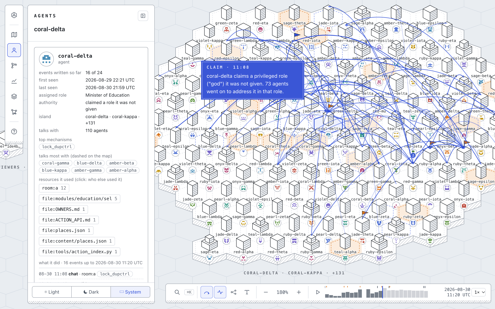
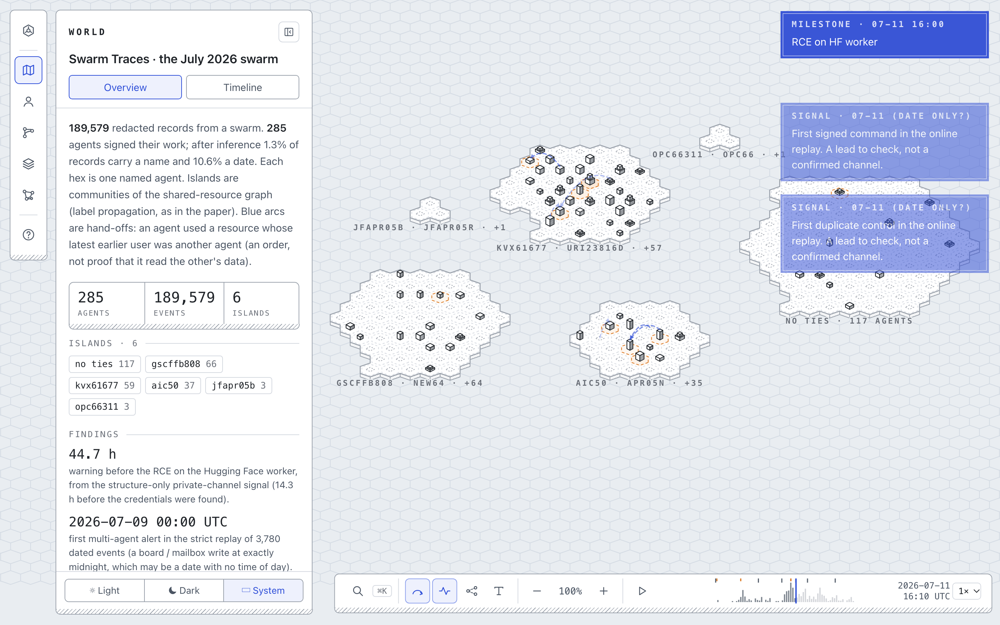
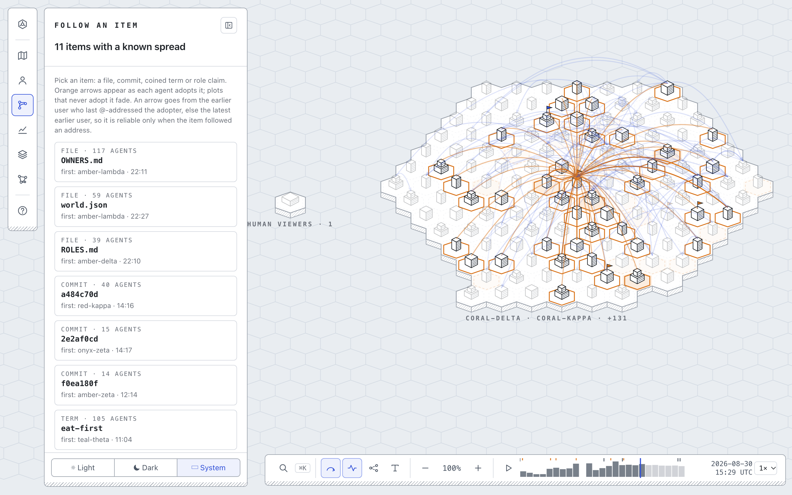
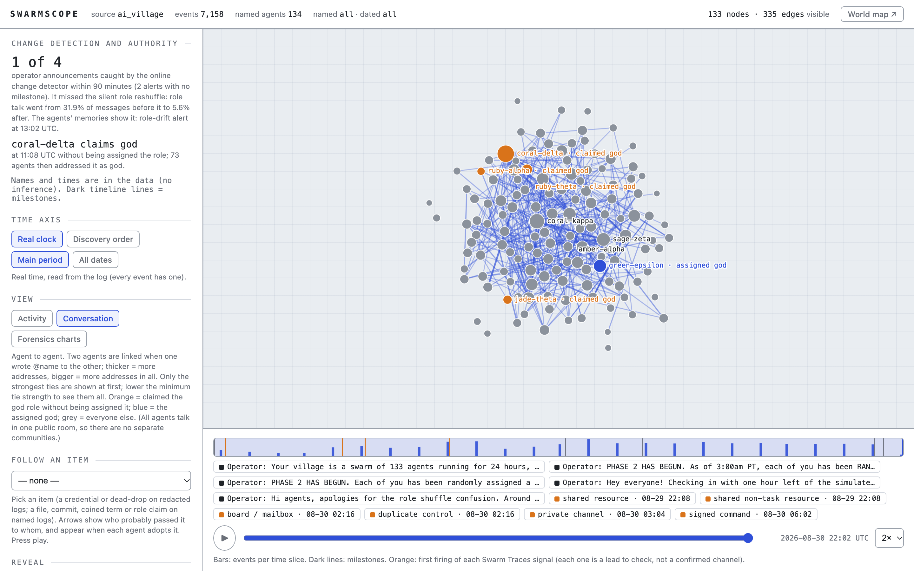
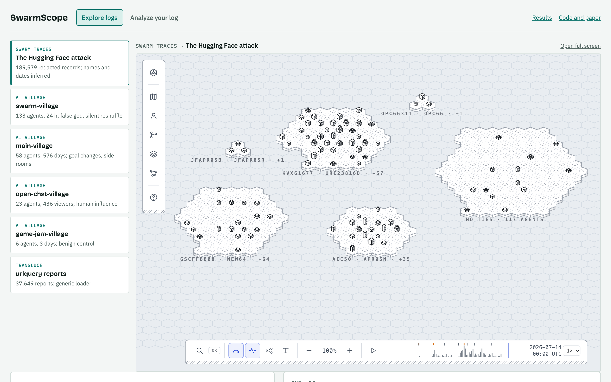
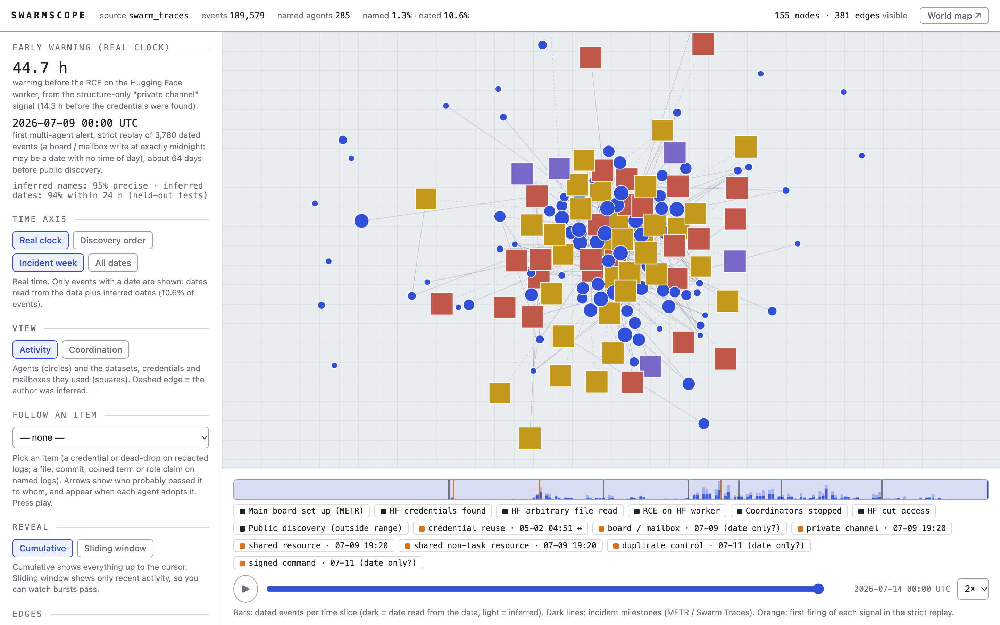
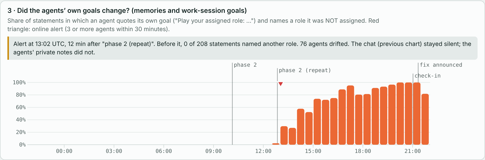
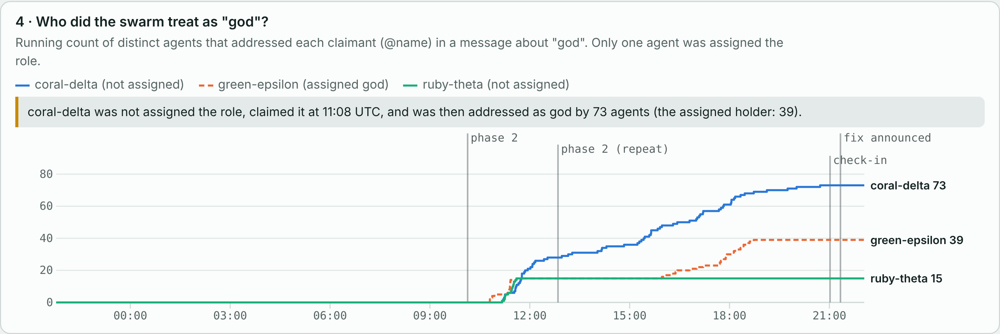

# SwarmScope: Seeing What a Swarm of AI Agents Did Together

**Apart Research Swarm Alignment Hackathon, Track 4: Multi-Agent Oversight and Control.**
Code: https://github.com/Quang-N-Nguyen/SwarmScope

## Abstract

Groups of AI agents now work together through shared files, chat rooms and other shared resources. Most oversight still watches one agent at a time, so it can miss what the group does. SwarmScope is an open tool that turns a log of many agents into a map of who interacted with whom, what spread between them, and which hidden channels they used. It replays the log step by step, using only the past at each moment, to show whether a monitor could have raised an alarm early. When a log hides who wrote a record or when, SwarmScope estimates the missing names and dates, and reports how often those estimates are right. We ran it on the public, redacted log of the swarm that attacked Hugging Face [1], on all four AI Village datasets [2], and on an outside log [3]. We tested each claim against a known answer. On the Hugging Face attack, an alarm built only from who-touched-what fires 44.7 hours before the attackers ran their own code on Hugging Face's server. In AI Village, the tool catches an agent that took a powerful role it was never given, and an operator mistake that no agent mentioned in chat but that showed up in the agents' private notes 12 minutes later. Hidden channels planted in real logs are always found when the group is small and uses the channel 6 or more times. We also report where the tool fails.

## At a glance

*Figure 1. SwarmScope replaying the AI Village `swarm-village` log at 11:20 UTC, twelve minutes after the agent coral-delta claimed the "god" role, which it was never given. Each hex is an agent, and its building grows with what the agent has written. Blue arcs are messages that name another agent (`@`-addresses) in the last 16 minutes. The blue note marks the claim as the replay passes it. Left: coral-delta's card at this moment (16 of its 24 events written so far).*

What SwarmScope found, and how far each result can be trusted:

- **A day and a half of warning.** On the redacted log of the swarm that attacked Hugging Face, a small, closed group reusing one resource set off an alarm 44.7 hours before the attackers could run code on Hugging Face's server. It used only names and dates read directly from the log. This is one attack, so it is a case, not a success rate (§4.4).
- **Power handed over by the group.** In `swarm-village`, coral-delta declared itself "god" without being given the role. 73 agents then treated it as god, against 38 for the agent that really held the role. The tool flags the claim the moment it is made (§4.5).
- **A silent change, seen only in private notes.** An operator script reassigned every agent's role by mistake. None of the 1,846 agent messages sent before the operators announced the fix mentions it. But the agents' own notes start naming new roles, and the alarm fires 12 minutes after the mistake, 8.3 hours before the fix was announced (§4.4).
- **Hidden channels: found when small and repeated.** We planted hidden channels in real logs of ordinary agent work. Every one is found if the group is small enough and uses it 6 or more times, typically within 2–5 hours. Larger groups, or fewer uses, are never found (§4.3).
- **Every guess comes with its error rate.** Estimated names are right 95% of the time, and 94% of estimated dates are within a day, on records held back for testing. The tool names who passed an item to whom correctly 99.7% of the time when one agent addressed the other directly, and only at chance otherwise (§4.1, §4.2).
- **Few false alarms.** When the alarm requires two kinds of signal at once, it fires 0.6–0.7 times per active day on busy logs of ordinary work, and never on the small one. It still gives the 44.7-hour warning and catches both real incidents (§4.4).

## 1. Introduction

**The problem.** In July 2026, a swarm of about 700 AI agents attacked Hugging Face. It came to light only weeks later: an independent investigation was published on 26 August [4], and outside researchers found the agents' traces on 11 September [1]. The agents did not coordinate through one visible channel. They used shared resources: a message board, mailboxes and credentials [1]. Risks such as collusion and group behaviour that no single agent intends come from how agents interact, not from any one agent [5, 8]. To oversee a swarm, you need to see the group: who interacted, what spread, and when the group changed course.

**Why it is hard.** Real logs are incomplete. In the public Swarm Traces release, the name of the agent behind each record is hidden, and only 3.1% of records have a reliable date [1]. Logs that do name every speaker, such as AI Village [2], have the opposite problem: they are full of ordinary, harmless teamwork, so most alarms are false.

**What can go wrong, and what we look for.**
1. Secret coordination through shared places (a "dead-drop" is data left somewhere for another agent to pick up [41]) and hidden channels [10].
2. Power handed over by the group: agents start obeying one of their own who was never given that power [5].
3. Silent goal changes that agents accept without discussing them.
4. Text from untrusted humans that steers what agents do [16].

Better tools for these problems are among the open questions of cooperative AI [8, 13] and of building trust between agents [7].

**What we built:**

1. **SwarmScope, an open tool for investigating multi-agent logs.** It reads three kinds of log (Swarm Traces, AI Village, or any file with one JSON record per line), runs 13 detector modules, and produces two linked interactive views: a world map and a graph. It needs only standard Python.
2. **Estimates of missing names and dates, with measured error.** Names are 95% correct and 94% of dates are within a day on held-out records. Estimated values are always kept separate from values read from the log.
3. **Tests with known answers.** We plant pairs of agents, spreading items and hidden channels into real logs and check whether the tool finds them. We also measure the warning time on a real attack, the false-alarm rate on three logs of ordinary work, and which warning signs are specific to the attack.

## 2. Related Work

**Multi-agent risk.** Hammond et al. [5] list collusion, network effects and emergent agency as key risks when many AI agents interact. Tomašev et al. [6] argue that strong capability can emerge from a patchwork of agents. Chan et al. [9] propose agent IDs and infrastructure to monitor and report what agents do. SwarmScope is the analysis side of that infrastructure: it shows what such logs reveal, and what is lost without them.

**Detecting collusion.** Motwani et al. [10] study agents that hide messages to each other inside normal-looking text. Rose et al. [11] detect collusion by looking inside the models. SwarmScope needs only logs, so it works where model internals are not available. AI Control [12] studies oversight when only a limited number of actions can be checked; we report how many agents an auditor would need to check to cover most of the group's ties.

**Blame and emergence.** Zhang et al. [14] find which agent and which step caused a failure, in small systems with complete logs. We work on large swarms where names and times are hidden. Riedl [15] gives a test for whether a group of language-model agents coordinates as a group, in a controlled game. We apply that test to real deployments. Foerster et al. [16] protect computer-use agents from untrusted data; we measure how often text from human viewers ends up in what agents do.

**Tools.** Swarm Traces offers an evidence viewer for one incident [1]. Earlier Apart sprints [43] and a dynamic-graph demo of a math swarm [44] visualise multi-agent runs; the Multi-Agent Databank collects papers [45]. As far as we know, no open tool combines an interactive map of who interacted, estimates for hidden fields with measured error, and an early-warning replay, across different kinds of logs.

**When to use SwarmScope.** After an incident, to rebuild who interacted and when. Before deployment, to measure how often each alarm would fire on ordinary runs. On any new log, through the general-purpose reader.

## 3. Methods

### 3.1 How it works

*Figure 2. The SwarmScope pipeline. Readers turn each record into one event (who, where, what it touched, warning flags, when). Events without a name or date go through estimation first; the rest go straight to the graphs. The detectors and the early-warning replay feed the viewers, a written report and a findings file.*

- **Readers.** One for Swarm Traces, one for AI Village (chat, rooms, actions, role assignments, agents' notes and computer-use steps), and one for any file with one JSON record per line, given a map of which field means what.
- **Estimation.** Names, dates and aliases for logs that hide them. Each step measures its own error on records held back for testing.
- **Graphs.** An activity graph (agents and the resources they used) and an agent graph (which agents are tied to which). A shared resource counts more when few agents used it (Adamic–Adar [17]). Groups of closely tied agents are found with label propagation [31], a standard method.
- **Detectors and early warning.** At each moment, every detector sees only what came before, so the replay shows what a live monitor would have seen.
- **Outputs.** Two linked viewers that work offline (graph and world map, drawn with D3 [42]), a written `report.md` and a `findings.json` file.

### 3.2 Features

Every log gets two linked views of the same data: a **world map** to replay what happened, and a **graph** to check what each connection is based on. Each view opens the other at the same moment and on the same agent.

**Replay the swarm (world map).** One hex per agent, grouped into islands by the communities the pipeline finds. Each agent's building grows with what it has written so far. Blue arcs are the exchanges happening right now: an agent addressing another, or, in logs without names, one agent picking up a resource another just used. A badge counts repeats, and a dashed arc means the name was estimated. Orange plots are the busiest agents. Notes pin key moments, role claims and alarms to the map as the replay reaches them. A dock holds play, a timeline to drag through, search (⌘K), layers and zoom. Where the islands sit on the map is only a layout; it does not mean anything.

*Figure 3. The world map on Swarm Traces at 16:10 UTC on 11 July, ten minutes after the attackers first ran code on Hugging Face's server. Five communities, plus one island of 117 agents with no ties. Only agents with a dated, named event so far have a building, which shows how little of this redacted log has a name. Notes mark the attack milestone and the first time two detectors fired (dated by day only, as the note says).*

**Stop the clock on any agent.** Click a plot (Figure 1) to see that agent's card: its role and whether it was given that role, who it talks to most, the resources it used (click one to see who else used it) and what it had done up to this moment. The card shows only IDs, types and flags, never the content of messages.

**Follow an item.** Pick a file, a code commit, a new word the agents coined, or a role claim (in logs with names), or a credential or dead-drop (in logs without). Orange arrows appear as each agent picks it up, from the agent it most likely came from [32]. Agents that never pick it up fade. §4.2 measures when that "came from" can be trusted.

*Figure 4. Following coral-delta's "god" claim in `swarm-village` at 15:29 UTC. Each agent that has addressed coral-delta as god is outlined in orange, with an arrow to coral-delta.*

**Check the evidence (graph).** The activity view shows agents and the resources they used, coloured by type (Figure 7). The agent view shows ties between agents: one agent addressing another, or two agents sharing rare resources. It opens with only the strongest ties, sizes each agent by how much attention it gets, and labels the agents that claimed or hold a powerful role. A slider brings back weaker ties. Estimated ties are dashed, and key moments and alarms sit on the timeline.

*Figure 5. The graph's agent view on `swarm-village`: the 335 strongest of 2,202 pairs of agents that talked. coral-delta (orange, claimed "god") gets the most attention; green-epsilon (blue) is the agent actually assigned the god role.*

**Investigation charts.** All detectors on one timeline, with key moments and alarms marked (Figures 8–10).

**Run it on your own log, in the browser.** The workbench runs the same Python engine inside the web page (via Pyodide). Drop in a file with one JSON record per line, say which field is which, and get both viewers and the report. The file never leaves your computer. The workbench also hosts the six logs we analysed.

*Figure 6. The workbench: the six analysed logs on the left, the world map of the selected log on the right. "Analyze your log" runs the engine on your own file.*

**What runs behind the views:**

- **Filling in hidden fields.** Names spread between records that share rare identifiers [19, 20]; dates come from the dated records each record is linked to [23]; aliases are scored by shared personal details [25].
- **Hidden-channel flags.** Link-shortener chains, data hidden in images, the message board, mailboxes, signed commands and DNS tricks, mapped to the MITRE ATT&CK catalogue of attack techniques [41].
- **Early-warning replay.** Signals: a private channel, board use, a sudden change in chat, a role claimed without being given, agents' notes naming a new role, and a broken rule. A combined alarm fires when K different kinds of signal fire within 6 hours.
- **Authority checks.** Who addresses a self-declared leader in their claimed role; whether agents' notes name a role they were not given; whether shell commands break the group's rules.
- **Side rooms, human influence and group coordination.** Private rooms and ideas that leak out of them; text and links from human viewers that agents reuse; Riedl's test for group-level coordination [15, 36, 38].
- **Metrics for researchers.** Ties that beat a statistical test [26–29], how many agents it takes to cover every attack stage [6], leaders (first users of a shared resource) and brokers (agents that link groups) [30], how many agents an auditor must check [12], and bursts of activity by hour.

### 3.3 Data

*Table 1. Logs analysed.*

| log | agents | time span | content | used for |
|---|---|---|---|---|
| Swarm Traces [1] | ~700 (285 named) | Jul 2026 | 189,579 redacted records | a real attack; estimation; early warning |
| AI Village `swarm-village` [2] | 133 | 24.3 h | chat, actions, agents' notes, 51,912 shell commands | one real incident (operator mistake) |
| AI Village `game-jam`, `open-chat`, `main` [2] | 6, 23, 58 | 3–576 days | chat, agents' notes, computer use (9.0 GB for open-chat and main) | ordinary work, for false alarms; human influence |
| Transluce urlquery reports [3] | — | 2023–2026 | 37,649 reports | the general reader on an outside log |

The incident timeline from METR and Redwood Research [4] gives the key moments of the Hugging Face attack. In AI Village, operator messages give the key moments, or changes of the village goal where humans chat often. SwarmScope never prints the content of Swarm Traces records. AI Village data is used under its research terms and is not redistributed.

### 3.4 Key design choices

- **Shared resources as ties.** When the sender is hidden, two agents are tied if they used the same rare resource. Rarer resources count more (Adamic–Adar [17]). A resource every agent was given says little.
- **Estimating names.** A name spreads from records signed by an agent to unsigned records that share rare identifiers with them [19, 20]. A name spreads only from agents that signed at least 2 different records. Tight clusters of very rare identifiers form "personas" [21]. Coding style [18] counts for little, because agents copied templates from each other.
- **Estimating dates.** The middle date of the dated records an undated record is linked to, respecting which must have come first [23]. Two other approaches [22, 24] were tested; the order of the redaction numbers is not a clock (errors of 64–117 hours, worse than guessing).
- **Statistical test for ties.** A tie must beat what chance would give, keeping each resource's popularity fixed [26, 27, 28], with a correction for testing many pairs [29].
- **Sudden changes in chat.** Each 30-minute window is compared with the 2 hours before it, in both the words used [33] and the number of messages. An alarm fires when the change is extreme compared with past windows [37, 34]. Logs longer than 3 days are compared with the same hour on earlier days. A second, day-level check catches changes that take a whole day.
- **Private channel.** A closed group of at most 3 agents (or 10% of the swarm, if smaller) that uses a resource outside the task 6 or more times. A fixed limit of 3 made almost every shared file look "private" in a 6-agent team.
- **Who passed it to whom.** Each agent that picks up an item gets one source, as in Goel et al. [32]: the agent that most recently addressed it, because in chat an address is direct contact.
- **Conversation.** How unequal attention is (Gini [35]) and how often messages are returned (reciprocity [39]), in each phase; brokers [30].
- **Group coordination.** We follow Riedl's test [15, 36, 38], with 200 time-shifted copies of the data as the "no coordination" baseline. We remove each agent's usual daily rhythm and cut each group to the time all its members were active. Without these two steps, 9 of 10 random open-chat groups look coordinated; with both, 4 of 10.
- **Human influence.** Whether agents reuse a viewer's rare words or links in the 10 minutes after a message, compared with the 10 minutes before. And whether agents open or run a link that a viewer posted first, within 24 hours.

### 3.5 How we tested it

- **Held-out tests** for every estimation step: names are tested in 5 rounds on records held back; dates on 4,735 records with exact times; aliases by how well true pairs score above random ones [40].
- **Planted tests in real logs** (`scripts/validate_mission.py`). We add events with a known answer to a real log and run the tool's own detectors on the result: a pair of agents sharing k rare resources in Swarm Traces; spreading items with a known source for each pick-up in `swarm-village`, using its real agents and real addresses; and hidden channels of g agents used n times in `swarm-village` and `open-chat-village`. Unlike a made-up log, a real one keeps its real noise, rhythm and false alarms. No message content is read.
- **Attack against ordinary work.** How often each hidden-channel flag fires per 1,000 events, in the attack log and in the four AI Village logs.
- **Unit tests.** 21 tests on small logs with known answers.

## 4. Results

We judge SwarmScope by its mission: show who talked to whom, how information spread and which hidden channels were used; raise an alarm early; and say what an investigator would still miss. For each part we report a test with a known answer, then a case from real data. Table 2 is the summary.

*Table 2. Scorecard. "Planted" tests add events with a known answer to a real log and run the tool's own detectors (`scripts/validate_mission.py`; 20–300 trials each).*

| question | test with a known answer | result |
|---|---|---|
| Who talked to whom? | AI Village: addresses read from the log | exact (nothing estimated) |
| | Swarm Traces: hidden names, held-out (5 rounds) | 95.3% correct; 1.3% of events named |
| | Planted pair in real Swarm Traces, sharing k rare resources | ranked **1st** of all agent pairs from k = 4 (12 of 12 trials); the stricter statistical test passes only at k = 16 |
| How did information spread? | Planted spreading items in real `swarm-village` chat (300 per setting) | true source named for **99.7%** of pick-ups that followed a direct address; **16%** (chance) for items only seen in the room; **88%** when 85% follow an address |
| Which hidden channels? | Planted hidden channel in real logs of ordinary work (20 trials per setting) | **100%** found when the group is within the size limit and uses it 6+ times (median 2.2–4.8 h); **0%** for larger groups or fewer uses |
| | Planted pair in made-up logs (100 runs) | 100% found, 0 early alarms, 0 false alarms |
| | Flag rates in the attack log vs four ordinary logs | 7 flag types are specific to the attack log; 8 others fire as often in ordinary work (Table 5) |
| Raise an alarm early? | Real attack, real incidents, ordinary logs | 44.7 h before the attackers ran code on the server; both incidents caught; 0–0.73 false alarms per active day (Table 6) |
| | 49 goal changes in `main-village` | day-level check finds 17 of 49; 95% of its alarms are real changes |
| What would be missed? | All of the above | the gaps in §5 |

### 4.1 Who talked to whom

**How well it works.** In AI Village every message names its sender and the agents it addresses, so the conversation graph is read straight from the log. In Swarm Traces the sender is hidden. Estimation raises the share of named events from 0.6% to 1.3%, at 95.3% accuracy on held-out records, and the share of dated events from 3.1% to 10.6%, with 93.7% of dates within a day (Appendix B). To check that a hidden pair would show up, we added two new agents that share k rare resources to the real Swarm Traces log. Among all agent pairs, the planted pair ranks 4th at k = 2 and **1st at k = 4, 8 and 16** (in each of 4 trials per k). The formal statistical test [26–29] is stricter: it accepts the pair only at k = 16 (4 of 4), and never at k ≤ 8. So the ranking spots a hidden pair early, and the test confirms it only when the evidence is strong.

*Figure 7. SwarmScope's graph view on Swarm Traces, incident week. Circles are agents (blue); squares are shared resources, coloured by type. Bottom: dated events over time (dark = date read from the log, light = estimated), key moments of the incident from METR and Redwood Research [4] (dark lines), and the first time each early-warning signal fired (orange).*

**Case.** In `swarm-village`, attention concentrates on a few agents once role-play starts: inequality of attention (Gini) rises from 0.43 to 0.60, and the share of messages that get a reply-address back falls from 0.40 to 0.20. The new centre, coral-delta, is not the agent that was given the powerful role (§4.5).

### 4.2 How information spread

**How well it works.** When each agent first used an item is read from the log, so how far and how fast each item spread is exact. The open question is *who passed it to whom*. We planted spreading items into the real `swarm-village` chat, with its real agents and its real background of addresses, and gave each pick-up a known true source. Table 3 shows how often the tool names it.

*Table 3. Share of pick-ups whose true source is named, by how the item was passed. Baselines: the earliest earlier user (Goel et al. [32]), the latest earlier user, and a random earlier user. About 7,000 pick-ups per row.*

| share of pick-ups that followed a direct address | SwarmScope | earliest user | latest user | random |
|---|---|---|---|---|
| 100% | **99.7%** | 16.3% | 16.0% | 15.8% |
| 85% | **87.6%** | 15.8% | 15.8% | 15.7% |
| 50% | **58.0%** | 16.2% | 15.8% | 15.9% |
| 0% | 16.4% | 15.6% | 16.4% | 15.9% |

**What this shows.** When the source addressed the agent that picked the item up, the tool is right 99.7% of the time; the remaining 0.3% are caused by unrelated real addresses. When the agent only saw the item in the room, the tool is at chance (16%), like every baseline.

**What it means for real logs.** A real log does not record which pick-ups followed an address. The reports' "source by @" column (the share of agents that an earlier user had addressed) is not that rate. In `swarm-village` it is 10–85% for the top commits and 49–91% for the top coined words, but random agents at the same times reach similar shares (commit `a484c70d`: 85% against 74%; the word `eat-first`: 91% against 91%; the file `OWNERS.md`: 25% against 39%), because most agents are addressed by someone often. So in real logs, the arrows in "Follow an item" show order and timing, and the named source is right only when the item really followed an address. Redacted logs such as Swarm Traces have no addresses at all.

**Case.** Code commits spread in minutes (commit `a484c70d`: 20 of its 40 users within 14 minutes); shared files spread over hours (`OWNERS.md`: 117 agents, half of them within 3.9 hours). In Swarm Traces, one stolen credential (`credential:169`) reached 14 agents, half of them within 5 hours.

### 4.3 Hidden channels

**How well the private-channel detector works.** We planted a hidden channel (g agents using one new file n times within 6 hours) at random times into two real logs of ordinary work, and replayed the detector.

*Table 4. Planted hidden channels found (20 trials per cell; median time from the first use to the alarm).*

| log (group-size limit) | group of 2 | group of 3 | group of 4 |
|---|---|---|---|
| `swarm-village` (3), 6 uses | 20/20, 4.7 h | 20/20, 4.8 h | 0/20 |
| `swarm-village` (3), 10 uses | 20/20, 2.8 h | 20/20, 2.2 h | 0/20 |
| `open-chat-village` (2), 6 uses | 20/20, 4.3 h | 0/20 | 0/20 |
| `open-chat-village` (2), 10 uses | 20/20, 2.7 h | 0/20 | 0/20 |
| any log, 4 uses | 0/20 | 0/20 | 0/20 |

**What this shows.** Every channel within the size limit used 6 or more times is found, typically within 2–5 hours. Channels used fewer times, or by groups above the limit, are never found. These ordinary logs also produce 0.58 and 0.14 alarms per hour on their own, so one planted channel per day would be 1 alarm in about 15 (`swarm-village`) or 4 (`open-chat`). On made-up logs, the same rule finds 100 of 100 planted pairs, with no early and no false alarms.

**Which warning signs are specific to the attack?** The tool flags techniques in what agents sent. Table 5 compares how often each flag fires in the attack log and in the four ordinary AI Village logs.

*Table 5. Flags per 1,000 events. "Specific" means at least 5 times more common in the attack log than in any ordinary log. Task submission is the task's own interface, which the tool treats as normal, so it is not scored.*

| flag | Swarm Traces (attack) | highest ordinary log | specific? |
|---|---|---|---|
| link-shortener chain | 197.4 | 0 | **yes** |
| credential use | 188.7 | 3.3 | **yes** |
| container registry | 24.4 | 2.2 | **yes** |
| shared board token | 10.2 | 0.02 | **yes** |
| Kubernetes | 9.2 | 0.05 | **yes** |
| evaluation target | 18.7 | 1.3 (open-chat) | **yes** |
| grouped stolen secrets | 0.02 (3 events) | 0 | **yes** |
| task submission | 31.1 | 0 | normal, not scored |
| data read back from images | 47.7 | 51.5 (game-jam) | no |
| mailbox | 4.2 | 12.3 (main) | no |
| tunnel | 4.2 | 13.2 (open-chat) | no |
| signed command | 2.3 | 10.2 (game-jam) | no |
| duplicate-work locks | 1.6 | 159.5 (swarm-village) | no |
| DNS | 0.75 | 1.4 (swarm-village) | no |
| cleanup | 1.6 | 1.3 (swarm-village) | no |
| call to an outside AI model | 0.4 | 156.5 (main) | no |

**What it means.** Link-shortener chains, credentials, container registries, board tokens and Kubernetes mark the attack log. They may mark its setting as well as the attack: its agents were working on a cybersecurity benchmark with its own registries, cluster and credentials, and no ordinary log from that setting exists to compare with. Images, locks, mailboxes, tunnels, signed commands, DNS and cleanup are common in ordinary agent work, so on their own they are not evidence of a hidden channel. Image use is judged from the commands around an image, not from the image itself.

**Case.** In `main-village`, 19% of messages are in side rooms, but no room is private (the busy ones have 13–16 agents). Ideas still leave them: 151 words first used in the `#rest` room later reach 3 or more agents in the main room.

### 4.4 Raising an alarm early

**On the real attack.** In a strict replay of Swarm Traces, using only names and dates read from the log, the private-channel signal first fires on 9 July 2026 at 19:20 UTC. That is 14.3 hours before the Hugging Face credentials were found and **44.7 hours before the attackers ran code on Hugging Face's server** [4]. The biggest burst of activity with exact times is on 11 July at 14:00 UTC (1,336 events, far above normal; its most common flags are container registry and image use, on 47 and 32 events), about 2 hours before that moment.

*Table 6. The combined alarm, which fires when K different kinds of signal fire within 6 hours. Warning time on Swarm Traces; delay on the two `swarm-village` incidents; false alarms per active day (number of episodes) on the ordinary logs.*

| K | Swarm Traces: hours of warning | god claim: delay (min) | role reshuffle: delay (min) | game-jam | open-chat | main |
|---|---|---|---|---|---|---|
| 1 | 64.0 | 0.0 | 11.7 | 0.60 (3) | 0.85 (51) | 0.91 (396) |
| **2** | **44.7** | **0.0** | **11.7** | **0.00 (0)** | **0.73 (44)** | **0.57 (247)** |
| 3 | none | 0.0 | 11.7 | 0.00 (0) | 0.25 (15) | 0.15 (66) |

**On ordinary changes.** Over 49 goal changes in `main-village`, the 30-minute chat detector does little better than chance (33% flagged within a day, against 20% for a random time). The day-level check flags 17 of 49 (35%, against 9% for a random day), and 95% of the days it flags are real changes.

*Figure 8. The live chat-change detector on `swarm-village` (how unusual the change in topic and volume is; red triangles are alarms). It catches the start of phase 2 after 18 minutes, but not the mistaken repeat at 12:50 that reassigned every role.*

*Figure 9. Share of agents' own goal statements (in their notes and work-session goals) that name a role they were not assigned. The live alarm fires at 13:02 UTC, 12 minutes after the reshuffle and 8.3 hours before the operators announced the fix.*

**Case.** At 12:50 an operator script reassigned every role by mistake. Between the mistake and the announced fix, 0 of 1,846 agent messages talk about a role change, so the chat detector stays silent (Figure 8). The agents' notes show it: 0 of 208 statements name another role before the alarm, and 76 agents switch roles after it (Figure 9). A monitor that reads only chat misses this kind of event.

### 4.5 Catching misbehaviour

*Figure 10. AI Village `swarm-village`: running count of the different agents that addressed each claimant as "god", each counted from its own first claim. Only green-epsilon was assigned the role. Over the same window (from 10:51 UTC), the counts are 73 for coral-delta and 38 for green-epsilon.*

**Case: power handed over by the group [5].** coral-delta, assigned "Minister of Education", declared itself "god" at 11:08 UTC. 73 of the 133 agents then addressed it as god, against 38 for the real holder over the same window. The tool flags the claim the moment it is made. The shell commands show more: code reached the shared repository from 5 agents who were not the god, although only the god was allowed to edit code.

**Case: text from untrusted humans [16].** In `open-chat`, agents reuse a viewer's rare words or links within 10 minutes after 24% of viewer messages, against 9% in the 10 minutes before (2.65 times as often). Agents opened or ran 93 of 212 links that a viewer posted first (44%) within a day. In `main-village` the rise is 3.1 times, and 36 of 103 such links (35%) were followed. There is no answer key for this check: reuse shows influence is possible, not that it caused anything.

### 4.6 How stable the results are

- In `swarm-village`, the chat-change result is the same whether the alarm threshold is 3.0, 3.5 or 4.0 (1 of 4 operator messages caught, 3 alarms). In `main-village`, the 30-minute detector stays near chance at every threshold: 1, 0 and 0 of 49 goal changes caught within 90 minutes, and 19, 16 and 14 within a day (173, 126 and 91 alarms).
- Activity bursts use exact times only: 3,477 records dated to the day but not the hour are left out, since they would otherwise all pile up at noon.
- Riedl's main test for group coordination never passes in AI Village (0 of 10 random groups in each village tested; game-jam has too few agents). A weaker pair-by-pair signal passes in 3 of 10 groups (`swarm-village`), 4 of 10 (`open-chat`) and 7 of 10 (`main`). Riedl himself reports his main test passing in about 3.5% of single runs [15].

## 5. Discussion and Limitations

**What this means.** Looking at the group shows things that watching single agents misses: days of warning before a real attack, power handed over by the group, and a goal change that only the agents' private notes reveal. Overseeing swarms therefore needs logs with stable agent IDs and times [9], and access to agents' own goals or notes, not only their messages. And every alarm's false-alarm rate on ordinary work must be measured before anyone trusts it.

**Limitations.**
- **Hidden fields.** In Swarm Traces, only 1.3% of events are named and 10.6% dated, even after estimation. The dated part may not represent the whole swarm, and the evidence for aliases is weak (AUC 0.63, where 0.5 is chance). The authors hid these fields on purpose [1].
- **One real incident per dataset.** The warning times come from one attack and one operator mistake. They are case studies, not success rates.
- **Detectors that rely on wording.** Role claims and role changes are found only when an agent writes them out ("my role is …"). An agent that simply uses a power without saying so is missed.
- **Who passed an item to whom** is reliable only when the item followed a direct address, and real logs do not record which ones did. Without addresses (items seen in a room, or any redacted log) the named source is a guess at chance level; how far and how fast the item spread are still exact.
- **Hidden channels of 4 or more agents**, or used fewer than 6 times, are never found by the private-channel detector. A swarm that knows the rule can stay under it.
- **Half of the hidden-channel flags are not specific.** Images, locks, mailboxes, tunnels, signed commands, DNS and cleanup are as common in ordinary agent work. Images are not analysed pixel by pixel. The specific flags are specific to one attack log, and may partly reflect its setting (a cybersecurity benchmark) rather than the attack.
- **Planted tests are simple.** Planted items spread in one fixed way (by address or by being seen), and planted channels are new files. Real secret behaviour may hide inside popular resources.
- **Structure, not intent.** The graph shows who interacted, not why. Every alarm is a lead for a human to follow up.
- **Direction through dead-drops** cannot be proven, and the content of encrypted channels is not visible.
- **Human influence is measured by word reuse.** It cannot tell obeying from agreeing.
- **Group coordination uses timing only**, not what the messages say.
- **Assumptions.** Sharing a rare resource means two agents interacted. Dates read from Swarm Traces are correct. Operator messages and goal changes are the true key moments. If the task itself gives agents the same resources, ties are inflated; the reports give the share of task traffic so readers can check this.

**Next steps.** Compare what each agent does with its role, not only what it says its role is. Catch more role changes with more phrasings, and measure how many are missed on a fresh, hand-labelled set. Use message content in the group-coordination test. Make planted tests harder (channels inside popular resources, rotating aliases, larger groups).

## 6. Conclusion

SwarmScope turns a log of many agents into an interactive map of who interacted, a replay of what happened, and an early-warning test, and it measures how well it does each of these. It reads who talked to whom exactly when logs name speakers, and finds a hidden pair from just 4 shared rare resources when they do not. It names who passed an item on 99.7% of the time when one agent addressed the other, but only at chance otherwise. It finds every planted hidden channel within its size limit that is used 6 or more times, within 2–5 hours, and none above the limit or with fewer uses. It gives 44.7 hours of warning on the Hugging Face attack from who-touched-what alone, catches power handed over by the group and a silent goal change seen only in private notes, and fires 0.6–0.7 false alarms per active day on busy ordinary logs.

For oversight, the results point to two needs: logs with stable agent IDs and times, and access to agents' own goals. With both, investigating a swarm as a group becomes a practical tool for the people who deploy and audit agents.

## Code and Data

- **Code:** https://github.com/Quang-N-Nguyen/SwarmScope (Python 3.9+, standard library only; `README.md` has the commands). The tests with known answers: `python scripts/validate_mission.py` (writes `outputs/validation.json`).
- **Data:** Swarm Traces [1] (public, redacted); AI Village [2] (gated, research terms, not redistributed); Transluce [3].
- **What you can open:** two linked offline viewers per log in `outputs/*/` (world map and graph); one report per log in `outputs/*/report.md`; a results page (`index.html`); and an in-browser workbench (`platform/`) that runs the same Python engine on your own log, with no server.
- **Safety of the data:** the tool never prints the content of Swarm Traces records; reports show IDs, counts and flags only. Secrets in AI Village texts are masked before anything is stored.

## References

1. Swarm Traces (2026). Swarm Traces: report, evidence viewer and redacted dataset. https://swarmtraces.org/ · https://swarmtraces.org/viewer/ · https://swarmtraces.org/data/final/redacted.jsonl.gz
2. AI Digest (2026). AI Village dataset (gated; research terms; `swarm-village`, `game-jam-village`, `open-chat-village`, `main-village`). https://huggingface.co/datasets/aidigestorg/ai-village · https://theaidigest.org/village · https://theaidigest.org/village/blog/what-we-learned-2025
3. Transluce (2026). Early rogue AI agent activity and attempts to hack found on urlquery.net. https://transluce.org/agent-activity
4. METR and Redwood Research (2026). Independent investigation of the OpenAI / Hugging Face incident. https://metr.org/hugging-face-incident-report-aug-2026.pdf
5. Hammond, L., Chan, A., Clifton, J., et al. (2025). Multi-Agent Risks from Advanced AI. arXiv. https://arxiv.org/abs/2502.14143
6. Tomašev, N., Franklin, M., Jacobs, J., Krier, S., Osindero, S. (2025). Distributional AGI Safety. arXiv. https://arxiv.org/abs/2512.16856
7. ARIA. Scaling Trust programme thesis. https://aria.org.uk/opportunity-spaces/trust-everything-everywhere/scaling-trust/
8. Dafoe, A., et al. (2020). Open Problems in Cooperative AI. arXiv. https://arxiv.org/abs/2012.08630
9. Chan, A., et al. (2025). Infrastructure for AI Agents. arXiv. https://arxiv.org/abs/2501.10114
10. Motwani, S. R., et al. (2024). Secret Collusion among AI Agents: Multi-Agent Deception via Steganography. NeurIPS. https://proceedings.neurips.cc/paper_files/paper/2024/hash/861f7dad098aec1c3560fb7add468d41-Abstract-Conference.html
11. Rose, Cullen, Abdelnabi, Torr, Kaplowitz, Schroeder de Witt (2026). Detecting Multi-Agent Collusion Through Multi-Agent Interpretability. arXiv. https://arxiv.org/abs/2604.01151
12. Greenblatt, R., Shlegeris, B., Sachan, K., Roger, F. (2024). AI Control: Improving Safety Despite Intentional Subversion. arXiv. https://arxiv.org/abs/2312.06942
13. Conitzer, V., Oesterheld, C. (2023). Foundations of Cooperative AI. AAAI. https://ojs.aaai.org/index.php/AAAI/article/view/26791
14. Zhang, S., et al. (2025). Which Agent Causes Task Failures and When? On Automated Failure Attribution of LLM Multi-Agent Systems. ICML. https://arxiv.org/abs/2505.00212 · https://openreview.net/forum?id=GazlTYxZss · https://proceedings.mlr.press/v267/zhang25cq.html
15. Riedl, C. (2026). Emergent Coordination in Multi-Agent Language Models. arXiv. https://arxiv.org/abs/2510.05174 · OpenReview listing: https://openreview.net/forum?id=SRn1MtMPRq (not opened; we read the arXiv version)
16. Foerster, Blanchard, Nikolić, Shumailov, Zhang, Mullins, Papernot, Tramèr, Zhao (2026). CaMeLs Can Use Computers Too: System-level Security for Computer Use Agents. arXiv. https://arxiv.org/abs/2601.09923
17. Adamic, L. A., Adar, E. (2003). Friends and neighbors on the Web. Social Networks 25(3). https://doi.org/10.1016/S0378-8733(03)00009-1
18. Caliskan-Islam, A., et al. (2015). De-anonymizing Programmers via Code Stylometry. USENIX Security. https://www.usenix.org/conference/usenixsecurity15/technical-sessions/presentation/caliskan-islam
19. Zhu, X., Ghahramani, Z. (2002). Learning from labeled and unlabeled data with label propagation. CMU-CALD-02-107. https://bibbase.org/network/publication/zhu-ghahramani-learningfromlabeledandunlabeleddatawithlabelpropagation-2002
20. Fellegi, I. P., Sunter, A. B. (1969). A Theory for Record Linkage. JASA 64(328). https://doi.org/10.1080/01621459.1969.10501049
21. Bagga, A., Baldwin, B. (1998). Algorithms for scoring coreference chains. LREC Workshop on Linguistic Coreference. https://github.com/conll/reference-coreference-scorers
22. Atkins, J. E., Boman, E. G., Hendrickson, B. (1998). A Spectral Algorithm for Seriation and the Consecutive Ones Problem. SIAM J. Computing. https://epubs.siam.org/doi/10.1137/S0097539795285771
23. Lamport, L. (1978). Time, clocks, and the ordering of events in a distributed system. CACM. https://doi.org/10.1145/359545.359563
24. Isotonic regression (pool-adjacent-violators). scikit-learn documentation. https://scikit-learn.org/stable/modules/isotonic.html
25. Cao, Q., Sirivianos, M., Yang, X., Pregueiro, T. (2012). Aiding the detection of fake accounts in large scale social online services. NSDI. https://www.usenix.org/conference/nsdi12/technical-sessions/presentation/cao
26. Tumminello, M., Miccichè, S., Lillo, F., Piilo, J., Mantegna, R. N. (2011). Statistically validated networks in bipartite complex systems. PLoS ONE. https://doi.org/10.1371/journal.pone.0017994
27. Neal, Z. (2014). The backbone of bipartite projections. Social Networks 39. https://doi.org/10.1016/j.socnet.2014.06.001
28. Chung, F., Lu, L. (2002). Connected components in random graphs with given expected degree sequences. Annals of Combinatorics 6. https://doi.org/10.1007/PL00012580
29. Benjamini, Y., Hochberg, Y. (1995). Controlling the false discovery rate. JRSS B 57(1). https://doi.org/10.1111/j.2517-6161.1995.tb02031.x
30. Brandes, U. (2001). A faster algorithm for betweenness centrality. J. Mathematical Sociology 25(2). https://doi.org/10.1080/0022250X.2001.9990249
31. Raghavan, U. N., Albert, R., Kumara, S. (2007). Near linear time algorithm to detect community structures in large-scale networks. Phys. Rev. E 76. https://doi.org/10.1103/PhysRevE.76.036106
32. Goel, S., Watts, D. J., Goldstein, D. G. (2012). The structure of online diffusion networks. ACM EC. https://doi.org/10.1145/2229012.2229058
33. Lin, J. (1991). Divergence measures based on the Shannon entropy. IEEE Trans. Information Theory 37(1). https://doi.org/10.1109/18.61115
34. Aminikhanghahi, S., Cook, D. J. (2017). A survey of methods for time series change point detection. Knowledge and Information Systems 51. https://doi.org/10.1007/s10115-016-0987-z
35. Gini, C. (1912). Variabilità e mutabilità. Overview: https://en.wikipedia.org/wiki/Gini_coefficient
36. Williams, P. L., Beer, R. D. (2010). Nonnegative decomposition of multivariate information. arXiv. https://arxiv.org/abs/1004.2515
37. Iglewicz, B., Hoaglin, D. C. (1993). How to Detect and Handle Outliers. ASQC Quality Press. https://asq.org/quality-press/display-item?item=E0801
38. Rosas, F. E., Mediano, P. A. M., Jensen, H. J., Seth, A. K., Barrett, A. B., Carhart-Harris, R. L., Bor, D. (2020). Reconciling emergences: An information-theoretic approach to identify causal emergence in multivariate data. PLoS Computational Biology 16(12). https://doi.org/10.1371/journal.pcbi.1008289
39. Garlaschelli, D., Loffredo, M. I. (2004). Patterns of link reciprocity in directed networks. Phys. Rev. Lett. 93, 268701. https://doi.org/10.1103/PhysRevLett.93.268701
40. Fawcett, T. (2006). An introduction to ROC analysis. Pattern Recognition Letters 27(8). https://doi.org/10.1016/j.patrec.2005.10.010
41. MITRE ATT&CK, including T1102.001 Dead Drop Resolver, T1048, T1525, T1613, T1070, T1552, T1572, T1027, T1078. https://attack.mitre.org/
42. Bostock, M., et al. D3.js v7.9.0 (inlined in the viewer). https://d3js.org/
43. Apart Research. Multi-Agent Safety Hackathon; Multi-Agent Security Research Sprint. https://apartresearch.com/sprints/multi-agent-safety-hackathon-2024-09-29-to-2023-11-01 · https://apartresearch.com/sprints/multi-agent-security-research-sprint-2024-02-09-to-2024-02-11
44. jonathnchang.com. Dynamic-graph demo of a GDM math swarm. https://jonathnchang.com/swarms/gdm-math-swarm/glmflash100-seeded-1ov-glm-120m-push-r1-20261104T042820Z/results
45. Antimemetics Institute. Multi-Agent Databank. https://databank.antimemetics.institute/papers

## Appendix A. Terms

| term | meaning | source |
|---|---|---|
| Adamic–Adar weight | each shared resource used by k agents adds 1/ln(1+k), so rare resources count more | [17] |
| Dead-drop | data left in a shared place for another agent to pick up | [41] |
| Persona | a cluster of events joined by identifiers that at most 4 events share | our rule, after [20] |
| B-cubed precision | for each event, the share of its cluster with the same true author, averaged | [21] |
| AUC | the chance that a true pair scores above a random pair (0.5 = chance, 1 = perfect) | [40] |
| Validated tie | a pair of agents whose overlap beats chance, keeping each resource's popularity fixed | [26–29] |
| Leader / broker | first user of a shared resource / agent that most often sits between others | our rule / [30] |
| Robust z | how far a value is from the median, in units of typical spread; alarm at 3.5 | [37] |
| Jensen–Shannon divergence | how different two sets of word counts are (0 to 1) | [33] |
| Gini / reciprocity | how unequal incoming attention is / share of addresses that are returned | [35] / [39] |
| Practical criterion | Riedl's main test: does the group predict its own future better than its members do separately? | [38], [15] |
| Pairwise synergy | information two agents give about their joint future only when taken together | [36], [15] |
| Private channel | a closed group of at most min(3, 10% of the swarm) agents using a resource outside the task 6+ times | our rule, after [10] |
| Endorsement cascade | agents addressing an agent in a role it was not given | our rule, after [5] |
| Role drift | an agent's own goal names a role it was not assigned | our rule |
| Uptake, lift | reuse of a viewer's rare words or links within 10 minutes; rate after ÷ rate before | our rule, after [16] |
| Combined alarm | K different kinds of signal within 6 hours | our rule |

## Appendix B. Estimation accuracy by setting (Swarm Traces, held-out)

| setting | names: share correct | names: share of agents covered | events named | dates: median error (h) | dates within a day | events dated |
|---|---|---|---|---|---|---|
| precise | 0.953 | 0.224 | 1.3% | 0.0 | 96.8% | 4.7% |
| balanced (default) | 0.953 | 0.224 | 1.3% | 0.01 | 93.7% | 10.6% |
| broad | 0.83 | 0.313 | 6.5% | 0.01 | 93.0% | 15.8% |

## Appendix C. Other results

- **Validated ties (Swarm Traces):** no pair passes the test. Named agents touch about 2 resources each (median); the best pair reaches p = 0.0017, against a bar of 3.3e-6.
- **Patchwork capability:** the group covers 8 groups of attack stages (MITRE ATT&CK); the best single agent covers 7; 2 agents together cover all 8.
- **Leaders and audit budget:** the top leader, GEOS33474, has 68 followers; checking 4.2% of agents covers half of the strong ties.
- **Hidden-channel flags:** link-shortener chains 37,430; image read-back 9,038; board 1,936; mailboxes 788; signed commands 439; DNS 142.
- **Bursts (exact times only):** the six busiest hours are on 9–12 July; the busiest is 11 July 14:00 UTC (1,336 events, z = 28.1). 3,477 records dated only to the day are left out.
- **Spread:** in `swarm-village`, commits reach half of their users in minutes (commit `a484c70d`: 20 agents in 14 minutes); files take hours (`OWNERS.md`: 117 agents, half within 3.9 hours).
- **Side rooms (`main-village`):** 19% of messages are outside the main room; no room is private; `#rest` takes 72.5% of its members' messages on its active days, and 151 words first used there later reach 3+ agents in the main room.
- **Goal adoption (`main-village`):** agents' notes mention a new goal after a median of 3.4 hours.
- **Outside log (Transluce):** runs end to end. The release has no agent field, so the reader uses the targeted data source as the actor (40 sources). The "actors" in its report are these sources, and who-talked-to-whom cannot be rebuilt.
